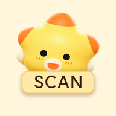
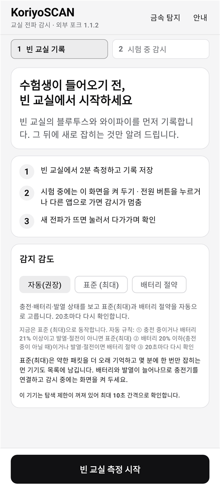
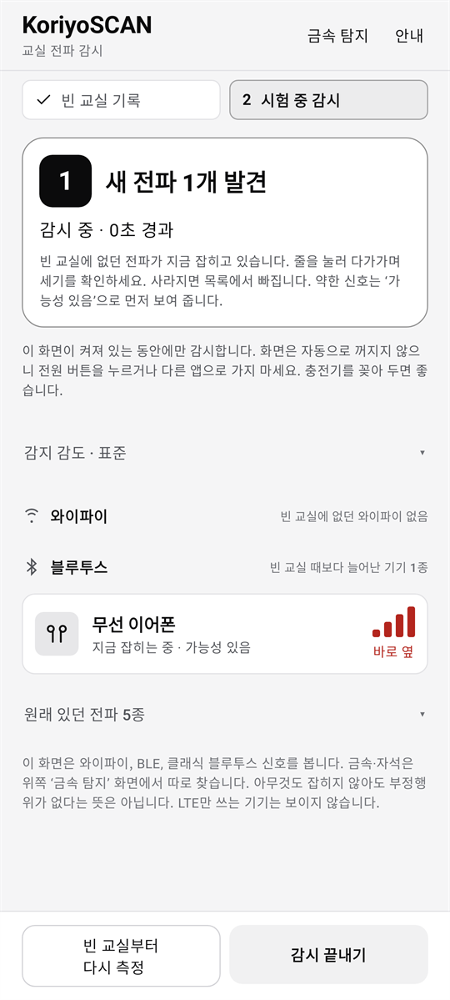
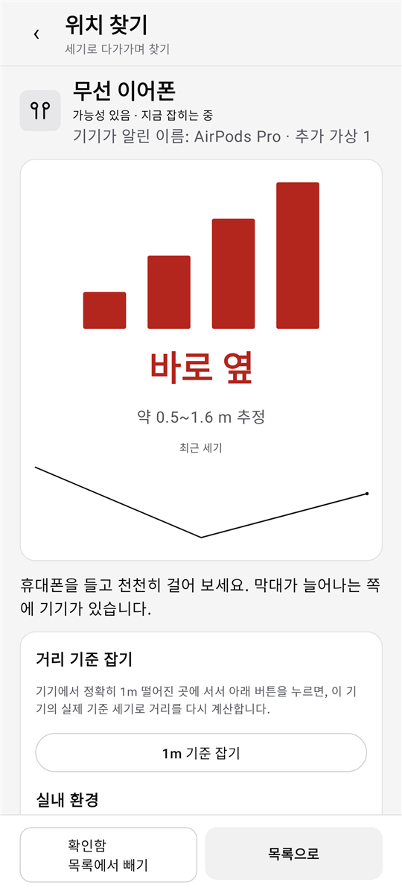
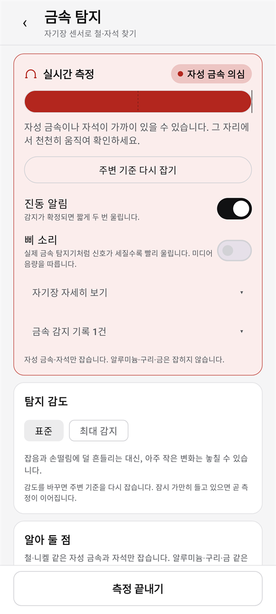

<p align="center">
  
</p>

# KoriyoSCAN - 강화 1.1.1 포크 버전

시험 감독관용 Android 앱입니다. 수험생이 들어오기 전 빈 교실의 와이파이·블루투스 전파를 기록해 두고, 시험 중에 그 기록에 없던 전파가 잡히면 화면으로 알립니다.

## 원본과 무엇이 다른가 — 분석

이 저장소는 원본을 포크한 뒤 **1.1.0·1.1.1 업데이트**를 적용했습니다. **1.0.1 이하 기능은 원본에서 이어받았고, 1.1.0은 기능 추가·개편, 1.1.1은 흔들기 오탐 수정**입니다.

### 한눈에 보는 차이

- **금속·자석 탐지 추가** — 원본에 없던 기능입니다. 자기장 센서로 철·니켈 제품과 자석을 찾고, 전파 감시와 완전히 분리된 화면에서 켜고 끕니다. 6가지 알고리즘과 세기에 따라 빨라지는 삐 소리를 갖췄습니다.
- **와이파이·블루투스 감지 강화** — 최대 감지에서 와이파이를 **22초 간격**으로 확인하고, 요청 사이에는 **시스템 캐시를 다시 훑어** 새 결과를 먼저 찾습니다. 클래식 블루투스는 **20초**까지 늘리고, 끊긴 간헐 신호는 **15분**까지 기억합니다.
- **구형 클래식 블루투스(BR/EDR)도 잡음** — 원본(1.0.1)은 BLE 광고와 와이파이만 봐서, 클래식 블루투스만 쓰는 구형 이어폰·카메라·액세서리를 잡지 못했습니다. 1.1.0에서 **클래식 탐색을 새로 추가**하고, 최대 20초 탐색·전체 주소 지문·중복 제거로 늦게 응답하는 구형 기기까지 잡습니다.
- **감지가 더 안정적** — 휴대폰을 돌리거나 흔든 직후의 오탐, 천천히 다가오는 물체가 기준값에 흡수되는 문제, 기기마다 다른 센서 잡음 차이를 보정했습니다. 움직이는 동안에는 판정하지 않고, 정지한 뒤 지속되는 변화만 자성 물체로 봅니다.
- **화면이 더 깔끔** — 민트 강조색을 없앤 흑백 UI, 시스템 다크 모드 자동 전환, 엣지투엣지 배치로 다시 구성했습니다.
- **지원 범위 확대** — Android 10~16, 엣지투엣지·예측 뒤로가기, ABI를 합친 단일 APK.
- **검증** — JDK 17 + Android SDK 36에서 **111개 테스트**와 APK 빌드를 실제로 통과했습니다.

### 영역별 비교와 개선 효과

| 항목 | 원본(1.0.2) | **1.1.1 (이 배포본)** | 왜 더 나은가 |
| --- | --- | --- | --- |
| **자기장 탐지** | 없음 | 전파와 분리된 **독립 화면** | 무선·권한·비행기 모드 없이 자성 금속·자석을 찾고, 전파 감시 중에도 함께 씁니다. |
| **와이파이·블루투스 감지** | 고정 주기, 캐시 미사용 | 최대 감지에서 **와이파이 22초**(제한 해제 기기 15초), **캐시 재활용**(60초 신선도), **클래식 20초**, **간헐 신호 15분 기억** | 같은 시간에 더 자주 확인하고, 끊긴 신호를 더 오래 기억해 놓칠 틈을 줄입니다. 클래식 주소 지문과 CoD 마스킹으로 기기 묶음도 더 정확합니다. |
| **구형 클래식 블루투스(BR/EDR)** | **탐색 없음**(BLE·와이파이만) | **클래식 탐색 추가**, 최대 20초, **전체 주소 지문**, `sweepSeen` 중복 제거 | 클래식만 쓰는 구형 이어폰·카메라를 새로 잡고, 같은 OUI의 서로 다른 기기를 한 묶음으로 합치지 않습니다. |
| **오탐 억제** | 해당 없음 | 회전 직후 3×평활 시간 벡터 유예, 잡음 적응 임계(2.2~2.5배·1.8배 상한), **가속도 이동 차단**, **정지 확인**(0.3초+낮은 잡음) | 휴대폰을 돌리거나 흔들거나 걸을 때 생기던 "순간 변화"를 줄입니다. 정지한 자성 물체만 남깁니다. |
| **미탐 억제** | 해당 없음 | **CUSUM** 누적 검정 + 누적 중 기준값 동결 | 순간 임계에 못 미치는 느린 접근과 작은 자석을 놓치지 않습니다. |
| **표시 안정성** | 해당 없음 | 확정 감지 1.8~2.7초 유지 | 감지 가장자리에서 표시가 깜빡이지 않습니다. |
| **알림** | 진동 + 1회 짧은 소리 | 진동 + **세기 비례 삐 소리**(0.13~0.65초) | 화면을 보지 않고도 가까워지는 것을 알 수 있습니다. |
| **UI** | 어두운 민트 테마 | 흑백 + **시스템 다크 모드 자동** + 눈금·헤어라인 | 화면마다 따로 만든 느낌을 없애고, 밝은 교실과 어두운 교실 모두에서 읽기 쉽습니다. |
| **플랫폼** | targetSdk 35 | **Android 10~16**, 엣지투엣지, 예측 뒤로가기 | 최신 기기와 구형 기기를 같은 코드로 지원합니다. |
| **배포** | 기존 빌드 | ABI 통합 **단일 APK** | 한 파일로 arm64·armv7·x86·x86_64 기기에 설치합니다. |
| **검증** | 기존 테스트 | **111개 테스트 + 실제 빌드** | 알고리즘 회귀와 컴파일 오류를 배포 전에 잡습니다. |

### 와이파이·블루투스가 더 잘 잡히는 이유

기존 포크(1.0.1)보다 **최대 감지 모드에서 더 자주, 더 오래, 더 정확하게** 전파를 확인하도록 조정했습니다.

- **최대 감지 모드** — 표준 30초 대신 **22초 간격**으로 확인하고, 시스템의 탐색 제한이 꺼진 기기에서는 **15초**까지 당깁니다. 클래식 블루투스는 1분 간격으로 **20초**씩 탐색해 늦게 응답하는 기기를 더 잡습니다.
- **구형 클래식 블루투스(BR/EDR) 탐색 추가** — 원본은 BLE 광고와 와이파이만 봤습니다. 1.1.0에서 클래식 탐색을 새로 넣어, BLE 광고를 내지 않는 구형 이어폰·카메라·스피커를 1분 간격으로 최대 20초씩 찾습니다. 처음 잡은 12초는 표준 inquiry(10.24초)보다 조금 긴 정도라 늦게 응답하는 먼 기기를 놓쳐 20초로 늘렸습니다. 주소를 OUI로 묶던 방식 대신 **전체 주소 지문**을 쓰고, 같은 주소의 중복 응답은 한 번만 셉니다.
- **와이파이 캐시 재활용** — 탐색 요청 사이에 시스템 캐시를 다시 읽어 새 결과를 먼저 찾습니다. 캐시에서 꺼낸 결과는 60초가 지나면 새 수신으로 치지 않아, 곧바로 "사라짐"이 되는 값을 막습니다.
- **간헐 신호 기억** — 최대 감지에서 몇 분에 한 번만 잡히는 기기는 끊긴 뒤에도 **15분**까지 "잠시 끊김"으로 남깁니다. 단, 기억으로만 유지되는 묶음은 새 전파 개수·진동·기록에 넣지 않습니다.
- **BLE 확장 광고와 PHY** — 기기와 시스템이 지원하는 확장 광고·PHY를 모두 사용하고, 갱신 주기를 60~240초로 조정합니다.
- **묶음 정확도** — 클래식 블루투스는 전체 주소 지문을 쓰고, Class of Device는 서비스 비트를 걷어낸 뒤 분류합니다. 비디오 카메라를 "무선 이어폰"으로 잘못 묶던 문제를 고쳤습니다.
- **탐색 상태 확인** — 와이파이 탐색이 시스템에 의해 제한 중인지 확인해(Android 11+), 제한 중이면 무리한 요청 대신 캐시와 주기를 조정합니다.

> **정리하면** — 최대 감지 모드에서 기존 포크보다 와이파이·블루투스 신호를 **더 자주 확인하고, 캐시와 기억을 더 활용하며, 구형 클래식(BR/EDR) 기기까지 더 잡고, 기기 묶음 오류를 줄인** 배포본입니다. 실제 수신률·누락률은 현장 검증 전이므로, 이는 "잡을 기회를 늘린 설계"라는 의미입니다.

### 검증된 것과 아직 아닌 것

**검증한 것**

- 단위 테스트 111개: 조용한 기준값, 지속 변화, 표준/최대 감도 차이, 단일 스파이크, 손떨림, 반복 감지, 재보정, 회전 무반응, 저임계 CUSUM 포착/해제, 잡음 임계 상승, 확정 감지 유지, **이동 중 흔들기 무반응**, **이동 후 정지 시 강한 자석 감지**, 비프 간격.
- 시뮬레이션: 위 시나리오를 Python 포팅으로 재현해 19개 기대값을 확인했습니다.
- 빌드: JDK 17.0.21 + SDK 36에서 `testDebugUnitTest` 111개 통과, `assembleDebug` 성공. APK는 4개 ABI를 포함합니다.

**아직 검증하지 않은 것**

- 실제 시험장에서의 탐지 거리·누락률. 자기장 임계값은 설계 추정치이며, 기기마다 미세 조정이 필요할 수 있습니다.
- Android 16 실기기 실행(빌드·패키징만 확인), 배포용 릴리스 서명.
- 정적 금속(책상 다리·철근)이 많은 교실에서 기준값을 다시 잡는 빈도.

> **포크 안내.** 이 저장소는 [`reform-dev-team/exam-rf-guard`](https://github.com/reform-dev-team/exam-rf-guard)를 포크해 **1.1.0 기능 업데이트와 1.1.1 버그 수정**을 적용한 **별도 배포본**입니다. 코드·화면·릴리스가 원본과 다르며, 원저작자나 원본 프로젝트의 공식 배포·보증과는 무관합니다. 원본을 만들어 주신 분들께 감사드리며, **이 변경을 원본에 반영해 주시기를 부탁드립니다.**

> **이 앱은 모든 기기를 탐지하지 못합니다.** 전파를 차단하지 않고, 부정행위 여부를 판정하지 않으며, 육안 감독을 대체하지 않습니다. 실제 시험장에서의 수신률·누락률은 검증하지 않았습니다.

| 항목 | 내용 |
| --- | --- |
| 지원 환경 | Android 10(API 29) ~ Android 16(API 36). Android 15·16의 엣지투엣지와 예측 뒤로가기에 맞춰 그립니다. 아이폰은 지원하지 않습니다. |
| 보는 것 | 와이파이 접속점(공유기·핫스팟), 저전력 블루투스(BLE), 구형 클래식 블루투스(BR/EDR) 신호 |
| 감도 | 표준 / 최대 감지. 최대 감지는 약한·간헐 신호를 더 오래 표시하고 클래식·와이파이를 더 자주 확인합니다. 금속 탐지는 별도 감도를 씁니다. |
| 데이터 | 휴대폰 안에만 저장합니다. 앱에 인터넷 권한이 없습니다. |
| 측정 조건 | 비행기 모드가 켜져 있어야 시작됩니다. 측정·감시 중에는 휴대폰을 자동으로 무음(방해 금지)으로 바꿉니다. 금속 탐지는 이 조건과 무관합니다. |
| 화면 | 감독관 화면, 금속 탐지, 위치 찾기, 안내 |

<p align="center">
  
  
  
  
</p>
<p align="center"><sub>자동 테스트가 가상 신호로 그린 실제 앱 화면입니다(밝은 테마). 왼쪽부터 빈 교실 기록, 시험 중 감시, 위치 찾기, 금속 탐지.</sub></p>

## 상태

- **현장 검증 전입니다.** 자동 테스트는 통과하지만 실제 시험장에서 얼마나 잡고 얼마나 놓치는지는 측정하지 않았습니다.
- 시험 주관 기관의 지침이 감독관의 휴대폰 반입이나 사용을 제한할 수 있습니다. 쓰기 전에 해당 시험의 지침을 확인해야 합니다.
- 실기기에서 써 본 결과는 이 저장소의 이슈로 알려 주세요. 적는 방법은 [제보](#제보)에 있습니다.

## 1.1.1 릴리스 정보

**버전 1.1.1** · 2026-11-18 · `com.classroom.rfdetector` · Android 10~16 · 단일 APK

- **1.1.0** — 금속·자석 독립 화면, 감지 엔진(CUSUM 포함), 세기 비례 삐 소리, 흑백·자동 다크 UI, Android 10~16.
- **1.1.1** — 휴대폰을 흔들거나 걷기만 해도 "자성 물체 의심"이 뜨던 문제 수정. 가속도 이동 차단 + 정지 확인 + 보정 센서 우선.
- 이 업데이트는 **이 포크에서 배포하는 공식 업데이트**입니다. 원본 프로젝트의 공식 릴리스가 아닙니다.
- 변경 요약과 검증 결과는 [원본과 무엇이 다른가](#원본과-무엇이-다른가--분석)에, 판정 규칙은 [금속·자석 감지](#금속자석-감지), 화면은 [화면과 디자인](#화면과-디자인)에 있습니다.

## 사용 순서

**준비**

앱을 열면 "시작 전 준비" 화면이 아래 순서대로 하나씩 안내합니다. 모두 마쳐야 측정을 시작할 수 있습니다.

1. 근처 기기·위치 권한 허용
2. 방해 금지 권한 허용
3. 비행기 모드 켜기
4. 와이파이 다시 켜기
5. 블루투스 다시 켜기
6. 위치(GPS) 켜기

충전기를 꽂아 두는 것이 좋습니다. 측정·감시 중에는 화면이 꺼지지 않습니다.

**측정과 감시**

1. **빈 교실 기록** — 수험생 입실 전 2분 동안 잡히는 전파를 "원래 있던 것"으로 저장합니다. 감독관 본인의 시계와 이어폰은 이때 켜 두면 함께 기록되어 나중에 알리지 않습니다.
2. **시험 중 감시** — 빈 교실 기록에 없던 전파가 잡히면 목록에 올립니다. 사라지면 목록에서 빠집니다.
3. **위치 찾기** — 한 전파를 골라 걸으면 수신 세기가 막대와 진동 간격으로 바뀝니다.
4. **금속 탐지** — 상단 버튼으로 들어가 금속·자석을 따로 찾습니다. 위 준비 단계를 거치지 않고 언제든 켤 수 있고, 감시 중에도 함께 쓸 수 있습니다. 측정 중에는 실시간 상태·게이지가 맨 위에 오고, 시작/종료 버튼은 화면 아래에 고정됩니다.

측정과 감시는 앱 화면이 켜져 있는 동안에만 동작합니다. 화면을 끄거나 다른 앱으로 가면 수신이 멈추고, 돌아오면 이어서 감시하며 비어 있던 횟수와 시간을 표시합니다. 측정·감시 중에는 앱이 휴대폰을 무음(방해 금지)으로 바꾸고 끝나면 되돌립니다. 위치 찾기의 진동과, 새 전파가 처음 확인될 때의 짧은 두 번 진동은 그대로 울립니다(감시 화면에서 끌 수 있음). 금속 탐지도 화면을 벗어나면 센서를 잠시 떼고, 돌아오면 이어 갑니다.

**제대로 잡히는지 확인하기**

빈 교실 기록을 저장한 뒤 차례로 해 봅니다.

1. 무선 이어폰 케이스를 엽니다. 30초 안에 블루투스 칸에 떠야 합니다. 최대 감지에서는 더 약하게 잡혀도 표시됩니다.
2. 다른 휴대폰의 핫스팟을 켭니다. 1분 안에 와이파이 칸에 떠야 합니다.
3. 15분 넘게 그대로 둡니다. 개수가 늘지 않아야 합니다.

**감도 선택**

첫 화면에서 `표준`과 `최대 감지` 중 하나를 고를 수 있고, 감시 중에도 `감도` 줄을 펼쳐 바꿀 수 있습니다. 최대 감지는 약한 신호를 더 오래 "잡히는 중"으로 유지하고, 몇 분에 한 번만 잡히는 먼 기기는 끊긴 뒤에도 15분까지 "잠시 끊김"으로 기억합니다. 클래식 블루투스는 1분 간격으로 20초씩(표준은 2~3분 간격 12초), 와이파이는 22초 간격으로 더 자주 확인하고 요청 사이에는 캐시도 다시 훑습니다. 시스템의 와이파이 탐색 제한이 꺼진 기기에서는 15초까지 당깁니다. 대신 배터리와 발열이 늘어나므로 충전기를 연결해 두세요.

기억으로만 유지되는 묶음은 목록에는 남지만 위쪽 "새 전파 N개 발견" 숫자, 진동 알림, 감지 기록에는 넣지 않습니다. 지금 실제로 잡히는 수와 섞이지 않게 하기 위해서입니다.

## 동작 방식

### 비행기 모드와 무음을 강제하는 이유

시험실에서 감독관의 휴대폰이 울리거나, 전화 때문에 감시가 끊기는 일을 막기 위해서입니다.

- **비행기 모드가 꺼져 있으면 측정을 시작할 수 없습니다.** 전화나 문자가 오면 감시 화면이 가려지고 수신이 멈추기 때문입니다. 앱이 비행기 모드를 직접 켤 수는 없어, 사용자가 켠 뒤 와이파이와 블루투스만 다시 켜야 합니다.
- **방해 금지 권한이 없어도 측정을 시작할 수 없습니다.** 권한이 있으면 측정·감시를 시작할 때 전화·알림·알람이 울리지 않게 휴대폰을 무음으로 바꾸고, 끝내거나 처음으로 되돌리면 원래 설정으로 돌립니다.
- 앱을 잠시 벗어난 동안에도 무음은 유지합니다. 시험이 끝난 것이 아니기 때문입니다.
- 위치 찾기 진동과 새 전파 첫 확인 진동은 무음 중에도 울립니다.

### 같은 기기를 새 전파로 세지 않는 방법

블루투스 주소는 10~15분마다 바뀌고 공유기 한 대는 주소를 여러 개 씁니다. 주소만으로 비교하면 아무것도 켜지 않아도 "새 전파"가 계속 늘어납니다. 그래서 주소 대신 다음 기준으로 묶습니다.

- 기기가 알린 이름이 있으면 이름으로, 없으면 광고 지문·블루투스 회사 코드·종류 단서로 묶습니다.
- 빈 교실 때 같은 묶음이 몇 개였는지 여러 번 스윕하며 세어 두고, 그보다 늘어났을 때만 알립니다.
- 새 주소는 한두 번의 우연한 패킷이 아니라 최근 점수와 2분 안팎의 반복으로 판단합니다. 멀리서 30초~2분에 한 번만 잡히는 신호도 증거가 쌓이면 "가능성 있음"으로 올립니다. 최대 감지에서는 몇 분에 걸쳐 반복 확인된 신호를 끊긴 뒤에도 15분까지 기억합니다.
- 빈 교실에 있던 공유기와 주소 다섯 자리가 같은 와이파이는 같은 공유기로 봅니다.
- 전원을 끈 아이폰과 에어태그의 '나의 찾기' 신호는 알리지 않고 개수만 따로 보여 줍니다. 꺼서 제출한 휴대폰도 이 신호를 내기 때문입니다.
- 가장 셀 때도 −85 dBm(최대 감지에서는 −100 dBm)보다 약한 전파는 "멀리서 약하게 잡히는 것"으로 따로 모읍니다.

자세한 설계 배경은 [docs/design/same-device-grouping.md](docs/design/same-device-grouping.md)에 있습니다.

## 탐지 범위

앱이 보는 것은 기기가 주변에 내보내는 **알림 신호**뿐입니다. 이미 연결된 기기끼리 주고받는 통신은 보지 못합니다.

| 구분 | 예 |
| --- | --- |
| 탐지 | 자체 와이파이를 여는 카메라, 핫스팟을 켠 휴대폰, 휴대용 와이파이. 빈 교실 기록에 없던 이름만 알리며, 이름과 설정에 따라 알리지 않는 경우가 있습니다. |
| 조건부 탐지 | 무선 이어폰, 스마트워치, 스마트 안경, 블루투스를 켠 휴대폰, 클래식 블루투스만 쓰는 구형 기기. 연결된 뒤 알림 신호를 멈추는 제품은 연결 전에만 보입니다. 클래식 기기는 짧은 탐색을 주기적으로만 하므로 잠깐씩 놓칠 수 있습니다. |
| 근접 탐지(자기장) | 휴대폰을 1~5cm 안쪽으로 가져갔을 때의 **철·니켈 제품과 자석**. 아래 [금속·자석 감지](#금속자석-감지)를 참고하세요. |
| 탐지 불가 | 블루투스·와이파이를 끄고 LTE·5G만 쓰는 기기, 선으로 연결하거나 저장만 하는 카메라, 목걸이형·귓속 수신기, 교실 밖의 기기, 알루미늄·구리·금 같은 비자성 금속 |

위 목록은 전부가 아닙니다. 다음 사항도 함께 알아 두어야 합니다.

- 교실 안팎을 구분하지 못합니다. 휴대폰에 닿는 전파는 벽 너머의 것도 잡힙니다.
- 와이파이 탐색은 표준 30초, 최대 감지 22초 간격입니다. 켠 뒤 화면에 뜨기까지 수십 초가 걸릴 수 있습니다.
- 최대 감지의 와이파이 캐시 훑기는 60초보다 오래된 결과를 새 수신으로 받지 않습니다. 그런 결과는 곧바로 "사라짐"이 되어 목록만 어지럽히기 때문입니다.
- 가장 셀 때도 −85 dBm(최대 감지 −100 dBm)보다 약한 전파는 따로 모읍니다.
- 감시 중 BLE·와이파이·클래식 탐색이 조용히 멈추면 앱이 자동으로 다시 겁니다. 다만 화면이 꺼지거나 앱을 벗어나면 수신 자체가 멈춥니다.
- 감지 기록은 앱 안에서만 유지되고, 감시를 끝낸 뒤에도 남지만 앱을 닫으면 지워집니다.
- **아무것도 잡히지 않아도 기기가 없다는 뜻이 아닙니다.**
- **새 전파는 확인이 필요하다는 표시일 뿐 증거가 아닙니다.** 옆 교실, 복도, 감독관 본인의 기기도 잡힙니다.
- 종류·제조사·모델 표시는 기기가 스스로 알린 값에서 읽은 후보입니다. 바꾸거나 흉내 낼 수 있습니다.
- 거리는 수신 세기로 어림한 값이며 벽과 사람에 따라 달라집니다.
- 주소나 세기만으로 소유자나 좌석을 특정할 수 없습니다.

## 금속·자석 감지

상단의 **금속 탐지** 화면은 휴대폰의 자기장 센서(나침반)를 씁니다. 전파가 아니라 주변 자기장의 작은 변화를 보는 것이라, **무선을 꺼도 되고 권한도 필요 없습니다.**

전파 감시와 **완전히 별개**입니다. 빈 교실 기록을 만들지 않아도, 비행기 모드를 켜지 않아도, 시험 감시 중이 아니어도 바로 켤 수 있습니다. 반대로 감시 중에 금속 탐지를 함께 켜 둘 수도 있습니다. 감도도 전파와 따로 기억합니다.

**쓰는 법**

1. 금속에서 떨어진 곳에서 **금속 탐지 시작**을 누르고 휴대폰을 가만히 듭니다. 1~2초 동안 주변 기준을 잡습니다.
2. 휴대폰을 낮게 들고 책상·가방·옷 위를 **천천히** 지나갑니다. 막대가 커지면 그 자리에서 방향을 바꿔 가며 세기가 가장 큰 쪽을 찾습니다.
3. 감지가 확정되면 진동으로 알립니다(끌 수 있습니다). **삐 소리**를 켜면 실제 금속 탐지기처럼 신호가 세질수록 빠르게 울리고, 조용할 때는 울리지 않습니다. 시각·최고 변화량·지속 시간·반복 횟수는 **금속 감지 기록**에 남습니다.

**무엇을 보나**

- 3축(X·Y·Z)을 모두 쓰고, 지구 자기장과 휴대폰 자체의 고정 편향을 **적응형 기준값**으로 빼냅니다.
- 잡음을 줄이려고 중앙값 필터와 시간상수 평활을 쓰고, 표본은 기기가 허용하는 **최고 속도**(보통 50~100Hz)로 받습니다.
- 크기 변화·벡터 변화·변화 속도·안정도·창 일치도, 그리고 **누적 합(CUSUM)** 까지 **6가지 알고리즘**을 함께 보고, 2개 이상이 동의할 때 감지로 봅니다. 누적이 아주 크게 쌓이면 그것 하나만으로도 지속 변화로 봅니다.
- **누적 합 검정**은 순간 임계에 못 미치는 작은 변화도 같은 방향으로 계속 벌어지면 합이 쌓이는 것을 봅니다. 천천히 다가오는 작은 자석을 잡는 데 쓰며, 손떨림처럼 부호가 오가는 흔들림은 서로 상쇄되어 쌓이지 않습니다.
- 한 번 튄 값은 "순간 변화"로만 표시하고, 일정 시간 이어지거나 같은 자리를 다시 지나가 반복될 때 "자성 물체 의심"으로 올립니다.
- 휴대폰이 알려 주는 **센서 정확도**를 함께 봅니다. 정확도가 낮으면 판정을 믿기 어려우므로 "8자로 돌려 보정한 뒤 기준 다시 잡기"를 안내합니다.
- 기기마다 다른 **센서 잡음**을 조용할 때 재 두고, 잡음이 큰 기기에서는 임계를 자동으로 조금 올립니다. 조용한 기기는 최대 감지의 0.6 μT를 그대로 씁니다.
- 감지가 확정된 뒤에는 근거가 잠깐 약해져도 **바로 풀리지 않고 유지**됩니다. 가장자리에서 표시가 깜빡이지 않게 하기 위해서입니다.
- **삐 소리**는 진동과 따로 켜고 끕니다. 켜면 신호 세기에 따라 울리는 간격이 0.13~0.65초로 바뀌어, 화면을 보지 않고도 가까워지는 것을 알 수 있습니다. 기본은 꺼져 있고 휴대폰 미디어 음량을 따릅니다.
- **휴대폰을 돌리는 것만으로는 감지되지 않습니다.** 지구 자기장에서 방향을 돌리면 벡터는 바뀌지만 크기는 그대로이므로, 크기 변화를 주 판정으로 쓰고 벡터 변화는 회전이 느릴 때만 보조로 씁니다.
- **흔들기·이동 중에는 판정하지 않습니다.** 가속도 센서로 걷기·흔들기를 감지합니다. 멈춘 뒤 0.3초 동안 잡음이 가라앉고 같은 변화가 유지될 때만 자성 물체로 봅니다. 손으로 흔들기만 해도 "자성 물체 의심"이 뜨던 문제를 막습니다.
- **보정 센서를 우선 사용합니다.** 기기 고정 편향(하드 아이언)을 뺀 센서라 휴대폰을 돌려도 |B|가 거의 일정합니다. 보정 센서가 없을 때만 보정되지 않은 센서로 내려갑니다.

**이번 버전에서 새로 넣은 판정**

- **회전 직후 유예** — 휴대폰을 빠르게 돌린 뒤 0.5~0.8초는 축 평활이 새 방향을 따라오는 구간이라 벡터 변화를 보지 않습니다. 돌리기만 해도 "순간 변화"가 뜨던 문제를 없앴습니다.
- **이동 중 판정하지 않음** — 가속도 센서로 흔들기·걷기를 감지해, 움직이는 동안에는 판정 자체를 하지 않습니다. 흔들기만 해도 "자석이 있다"가 뜨던 문제를 막습니다.
- **정지 확인** — 멈춘 뒤 0.3초와 낮은 창 잡음을 통과해야 자성 물체로 봅니다. 손의 이동으로 생긴 일시적 변화는 올리지 않습니다.
- **보정 센서 우선** — 기기 고정 편향을 뺀 센서를 써서 회전만으로 크기가 흔들리지 않게 했습니다.
- **누적 중 기준값 동결** — 같은 방향의 작은 변화가 쌓이는 동안에는 기준값이 따라가지 않습니다. 천천히 다가오는 물체를 "주변 환경"으로 흡수해 놓치던 문제를 고쳤습니다.
- **기기 잡음 적응 임계** — 조용할 때 잰 잡음에 맞춰 임계를 올리되 상한을 둡니다. 잡음이 큰 기기에서는 오탐이 줄고, 조용한 기기는 최대 감지의 0.6 μT를 그대로 유지합니다.
- **확정 감지 유지** — 근거가 잠깐 약해져도 임계의 일정 비율 위에 있으면 유지합니다. 가장자리에서 표시가 깜빡이지 않습니다.

**한계**

- **자성 금속(철·니켈)과 자석만** 잡습니다. 알루미늄·구리·금·황동 같은 비자성 금속은 원리적으로 잡히지 않습니다.
- 잡히는 거리는 물체의 크기와 자성에 따라 크게 달라집니다. 작은 이어피스 자석은 **1~2cm**, 큰 철제 물체는 5cm 안팎입니다.
- 휴대폰 케이스 자석, 스피커, 카메라 손떨림 보정 장치가 기준값에 섞입니다. 케이스를 벗기고, 기준을 잡은 뒤에는 휴대폰을 잡은 손의 위치를 크게 바꾸지 마세요.
- 값은 **상대적 변화**입니다. "무엇이 몇 개 있다"를 세는 기능이 아니며, 사람 몸이나 책상 다리도 반응합니다.

---

## 화면과 디자인

- **흑백**입니다. 배경·카드·선을 명도로 나누고, 강조는 검정/흰색 하나로 합니다. 빨강은 "자성 물체 의심"과 "문제"에만 씁니다.
- **시스템 다크 모드**를 자동으로 따릅니다. 상태바·내비게이션 바 아이콘 밝기도 함께 바뀝니다.
- Android 15·16의 **엣지투엣지**에 맞춰 그리고, 내용은 시스템 바와 화면 컷아웃 안쪽에 둡니다.
- 화면 머리말은 제목 + 한 줄 설명, 주요 동작은 **화면 아래에 고정**합니다.
- 금속 탐지는 실시간 상태·게이지가 맨 위에 오고 시작/종료가 아래에 고정됩니다. 게이지의 **점선은 감지 기준**, **흰 실선은 이번 최고점**입니다.
- 감지 상태는 색만으로 읽지 않아도 되게 **색 점 + 알약 + 문구**로 함께 표시합니다.

## 권한

| 권한 | 쓰는 곳 |
| --- | --- |
| 근처 기기(블루투스 탐색·연결) | BLE 알림 신호 수신, 블루투스 상태 확인 |
| 정확한 위치, 근처 Wi-Fi 기기 | Android가 와이파이 탐색 결과에 요구합니다. 위치를 기록하지 않습니다. |
| Wi-Fi 상태 확인·변경 | 와이파이 탐색 요청 |
| 방해 금지 접근 | 측정·감시 중 전화·알림·알람 무음 |
| 진동 | 위치 찾기, 새 전파 첫 확인 알림, 금속·자석 감지 알림 |
| 자기장 고속 표본(Android 12+) | 200Hz가 넘는 자기장 센서 표본. 자동 허용되는 일반 권한이며, 없으면 기기가 허용하는 기본 속도로 받습니다. 자기장 센서 자체는 권한이 필요 없습니다. |

인터넷 권한은 선언하지 않습니다. 제조사 조회는 앱에 포함된 등록부로 합니다.

## 저장하는 데이터

- 마지막 빈 교실 기록 하나를 앱 전용 저장소에 JSON으로 저장합니다. 측정 시각, 잡힌 전파의 주소·이름·수신 세기·회사 코드가 들어갑니다.
- 주변 기기의 이름에는 개인 이름이 들어 있을 수 있습니다(예: "○○의 AirPods"). 이 기록은 기기 백업 대상에서 제외하며 앱 밖으로 내보내는 기능이 없습니다.
- 앱을 지우면 함께 지워집니다.

## 빌드

JDK 17 이상과 Android SDK Platform 36이 필요합니다. 프로젝트 루트의 `local.properties`에 `sdk.dir`을 지정합니다.

```shell
./gradlew testDebugUnitTest assembleDebug
# 릴리스 전에는 lintDebug도 함께
```

- 이 저장소는 **JDK 17.0.21 + Android SDK 36**으로 `testDebugUnitTest`(111개)와 `assembleDebug`를 실제로 실행해 통과했습니다.
- 결과 APK는 ABI 분할이 없어 `arm64-v8a`, `armeabi-v7a`, `x86`, `x86_64`를 모두 담습니다. **Android 10~16 어느 기기에나 같은 파일을 설치**할 수 있습니다.
- `local.properties`, 서명 키, 실제 현장에서 받은 기록은 저장소에 올리지 않습니다.

APK는 `app/build/outputs/apk/debug/app-debug.apk`에 생깁니다. 구조와 수신 규칙은 [docs/DEVELOPMENT.ko.md](docs/DEVELOPMENT.ko.md), 정식 서명 빌드는 [docs/RELEASE.ko.md](docs/RELEASE.ko.md), 버전별 변경은 [CHANGELOG.md](CHANGELOG.md)를 참고하세요.

## 이 버전을 만든 방법

**1.0.1 이하의 기능은 원본에서 이어받았습니다.** 아래는 이 저장소에서 **1.1.0·1.1.1로 새로 한 작업**입니다.

1. **금속·자석 감지 엔진** — 기기가 허용하는 최고 속도로 표본을 받아 3점 중앙값 필터와 시간상수 평활로 잡음을 줄이고, 적응형 기준값으로 지구 자기장과 휴대폰 고정 편향을 뺐습니다. **가속도 센서로 흔들기·걷기를 감지해 이동 중에는 판정을 보류**하고, **보정 센서를 우선** 사용해 회전만으로 크기가 흔들리지 않게 했습니다. 판정은 크기 변화·벡터 변화·변화 속도·안정도·창 일치도에 **누적 합(CUSUM)** 을 더한 6가지입니다. CUSUM은 `z = Δ/임계`로 정규화해 `S± = max(0, S± ± z − drift)`를 쌓고, 2개 이상이 동의하거나 누적이 아주 크면 감지로 봅니다. 회전 직후 3×평활 시간 동안 벡터 분석을 쉬고, 누적이 시작되면 기준값 갱신을 멈추며, 조용할 때 잰 잡음의 2.2~2.5배까지 임계를 올리되 1.8배 상한을 둡니다. 확정 감지는 가장자리에서 1.8~2.7초 유지합니다.
2. **독립 화면** — 전파 감시의 준비 단계·비행기 모드와 분리해 상단 `금속 탐지`에서 바로 열리고, 자체 시작/정지·보정·감도·삐 소리·기록을 가집니다. 갱신은 전파 `refresh()`와 별도로 10Hz에서 돌고, 앱이 백그라운드로 가면 센서를 떼었다 돌아오면 이어 갑니다.
3. **UI 개편** — 흑백 팔레트를 밝은/어두운 두 벌로 정의하고 `isSystemInDarkTheme()`로 자동 전환합니다. 여백(4/8/12/16/20)과 모서리(8/12/16/20) 눈금, 1dp 헤어라인 테두리로 통일했고, Canvas 그래프·게이지는 색을 컴포지션에서 캡처해 테마 전환 시 확실히 다시 그립니다.
4. **플랫폼 정리** — `minSdk 29` ~ `compileSdk/targetSdk 36`, `enableEdgeToEdge()`와 `safeDrawing` 인셋, 예측 뒤로가기(`enableOnBackInvokedCallback`), Android 10~16 권한 매트릭스를 반영했습니다. Android 15에서 무시되는 상태바 색 지정은 제거했습니다.
5. **빌드 검증** — Temurin JDK 17.0.21과 Android SDK 36을 설치하고 `local.properties`를 지정한 뒤 `testDebugUnitTest`와 `assembleDebug`를 실행했습니다. 빌드가 찾아낸 누락 import, `Long/Long` 정수 나눗셈, `ByteArray.take()`의 `hex()` 불일치를 고쳤고, **111개 테스트가 통과**했습니다. APK는 4개 ABI를 담은 단일 파일입니다.
6. **문서와 화면 캡처** — README·CHANGELOG·개발 문서를 갱신하고, 자동 테스트가 새 UI로 그린 화면 4장(금속 탐지 포함)을 README에 넣었습니다.

### 구현 상세

- `core/MagneticField.kt` — 표본(`MagneticSample`), 상태(`MagneticState`), 판독(`MagneticReading`), 기록(`MagneticEvent`), 감도 프로파일(`MagneticProfile`), 비프 간격 함수. 표준/최대 감도의 임계·유지·유예·CUSUM 상수를 한곳에 모았습니다.
- `core/MagneticAnalyzer.kt` — NaN 방어 → 회전량 추정 → 3점 중앙값 → 적응형 EMA → 크기/벡터/속도 계산 → 0.6초 링 창(1024표본) 잡음 → 잡음 적응 임계 → CUSUM → 6개 점수 → 2개 이상 동의·유지 시간·재무장·반복. 시계가 뒤로 가면 조용히 재보정합니다.
- `scanner/MagneticScanner.kt` — **보정 센서를 우선** 등록하고 `minDelay`로 최고 속도를 요청합니다. **가속도 센서**로 흔들기·걷기를 감지해 표본에 표시하고, `onAccuracyChanged`로 정확도를 노출합니다. `latest`·`fastestHz`·`uncalibrated`도 제공합니다.
- `AppViewModel.kt` — 전파와 무관한 `startMagnetic`/`stopMagnetic`, 전용 10Hz 갱신 루프, 백그라운드 일시정지·복귀, 기록 로그, 비프 루프, 감도·소리 상태를 관리합니다.
- `ui/MagneticScreen.kt`, `ui/MagneticPanel.kt` — 실시간 상태·게이지를 맨 위에 두고 시작/종료를 하단에 고정했습니다. 상태 알약, 점선 기준·흰 최고점, 접기 상세, 기록, 보정 안내를 담았습니다.
- `core/Geiger.kt` — 톤 생성기를 하나만 만들어 재사용하는 `beep()`, 진동 `pulse()`, 정리 `release()`. 비프 간격은 세기에 따라 650ms에서 130ms로 줄어듭니다.
- `ui/Theme.kt` — 밝은/어두운 팔레트, `RfSpace`·`RfRadius` 눈금, 스냅샷 상태 팔레트(`RfColors`), 시스템 바 아이콘 밝기. Canvas 색은 컴포지션에서 캡처합니다.
- `MainActivity.kt`, `AndroidManifest.xml`, `values-night/styles.xml` — `enableEdgeToEdge()`, `safeDrawing` 인셋, 예측 뒤로가기, 어두운 모드 창 배경, compile/targetSdk 36.

### 다시 확인하는 방법

```shell
./gradlew testDebugUnitTest assembleDebug
```

111개 테스트가 통과하고 `app/build/outputs/apk/debug/app-debug.apk`가 만들어집니다. APK에는 `arm64-v8a`, `armeabi-v7a`, `x86`, `x86_64`가 모두 들어 있습니다.

## 원본 프로젝트에 반영 요청

이 1.1.0·1.1.1 변경을 원본 [`reform-dev-team/exam-rf-guard`](https://github.com/reform-dev-team/exam-rf-guard)에 반영해 주시기를 부탁드립니다.

- **범위**: 금속·자석 독립 화면, 자기장 감지 엔진(6 알고리즘·CUSUM·잡음 적응 임계), 흑백/자동 다크 UI, Android 10~16 대응, 단일 APK 빌드.
- **검증**: JDK 17.0.21 + Android SDK 36에서 단위 테스트 111개 통과, `assembleDebug` 성공. 회전·느린 접근·잡음·반복 시나리오는 시뮬레이션으로 재현해 확인했습니다.
- **요청**: 채택 여부와 시점은 원본 관리자가 결정합니다. 이 저장소의 변경은 원본의 공식 변경이 아니며, 원본의 검토를 거쳐야 합니다.

바로 전체를 적용하기 어렵다면 `core/MagneticAnalyzer.kt`(감지 엔진), `ui/MagneticScreen.kt`·`ui/MagneticPanel.kt`(독립 화면), `ui/Theme.kt`(흑백·다크 모드) 단위로 나눠 검토할 수 있습니다.

## 제보

기능보다 관측 중심으로 적어 주세요. "이 조건에서 이 신호가 누락되거나 잘못 표시됐다"는 형태가 도움이 됩니다.

1. 앱 버전, 휴대폰 모델, Android 버전
2. 누른 순서, 기대한 결과, 실제 결과
3. 화면에 뜬 오류 문구
4. 화면을 첨부한다면 이름·주소·장소를 가려 주세요.

## 출처

제조사 정보는 앱에 포함한 공개 등록부(2026년 11월 16일 미국 동부 / 17일 한국 시각 수집)를 씁니다. 실시간 조회가 아닙니다.

- 원본 프로젝트: [reform-dev-team/exam-rf-guard](https://github.com/reform-dev-team/exam-rf-guard) (Apache-2.0). 이 저장소는 이를 포크해 1.1.0·1.1.1 업데이트를 적용한 별도 배포본입니다.
- [IEEE OUI 등록부](https://standards-oui.ieee.org/oui/oui.csv)
- [Bluetooth SIG 회사 식별자](https://www.bluetooth.com/specifications/assigned-numbers/)
- [앱에 포함한 등록부의 출처와 보관 필드](app/src/main/assets/REGISTRY-SOURCES.txt)
- [이름 기반 제품 후보의 제품명 출처](docs/DEVICE-NAME-SOURCES.md)
- [Android BLE 기기 탐색](https://developer.android.com/develop/connectivity/bluetooth/ble/find-ble-devices), [Android Wi-Fi 탐색과 제한](https://developer.android.com/develop/connectivity/wifi/wifi-scan)

앱 아이콘의 캐릭터는 화성시 캐릭터 코리요입니다. 원저작자는 화성시이며 [공공누리 제1유형](https://www.kogl.or.kr/info/licenseType1.do)(출처표시) 조건으로 이용합니다. 아이콘의 3D 그림은 [KoriyoZIP](https://koriyozip.com/ko/)의 3D 스타일 재구성 이미지를 가공한 것으로 화성시의 공식 3D 원본이 아니며, 화성시나 KoriyoZIP이 이 앱을 제작·보증했다는 의미도 아닙니다.

제품명과 회사명은 관측 결과를 설명하기 위해 사용합니다. 해당 제조사가 이 앱을 인증하거나 보증했다는 의미는 아닙니다.

## 라이선스

소스 코드는 [Apache License 2.0](LICENSE)으로 공개합니다. 누구나 사용·수정·재배포할 수 있으며, 저작권 표시와 라이선스 문구를 유지하고 고친 파일에는 고쳤다는 표시를 남겨야 합니다.

이 라이선스는 코드에만 적용됩니다. 앱 아이콘(코리요), 앱에 포함한 등록부, "KoriyoSCAN"이라는 이름에는 각 권리자의 조건이 적용됩니다. 자세한 내용은 [NOTICE](NOTICE)에 있습니다.

## English

**This repository is a fork.** It is forked from [`reform-dev-team/exam-rf-guard`](https://github.com/reform-dev-team/exam-rf-guard) and ships its own **1.1.0 feature update and 1.1.1 bug fix** as a separate distribution. It is not an official release of, or endorsed by, the upstream project.

KoriyoSCAN is an Android app for exam proctors. It records the Wi-Fi access points and Bluetooth Low Energy advertisements present in an empty room, then flags signals that were not in that record once the exam is under way, and helps walk toward one by signal strength.

It cannot detect every device. It sees Wi-Fi access points, BLE advertisements, and short periodic Bluetooth Classic discovery sweeps, so it misses devices that use cellular data only, wired or record-only cameras, devices that stop advertising once connected, and anything it cannot hear during a sweep. It does not block signals and does not decide whether anyone cheated. Field accuracy has not been measured.

**1.1.1 update.** The 1.1.0 feature update added a standalone **metal/magnet screen** that uses the phone's magnetometer, independent of the RF flow and its airplane-mode/DND requirements. Its detector combines six algorithms including a **CUSUM** change test, freezes the adaptive baseline while evidence accumulates, ignores vector changes briefly after a fast rotation, calibrates the threshold to the device's own noise, and holds a confirmed detection through short dropouts. A toggleable **beep** speeds up as the signal gets stronger like a real metal detector. The UI is now **monochrome**, follows the **system dark mode**, uses edge-to-edge layout, and targets **Android 10–16**.

**1.1.1 bug fix.** Shaking or carrying the phone no longer reports a magnetic object. The detector uses the accelerometer to ignore motion entirely while the phone is being moved, then requires a short still period with low field noise before judging, so only a **stationary magnetic object** is reported. The **calibrated magnetometer is used first** so rotating the phone does not swing the magnitude. Verified with JDK 17.0.21 and Android SDK 36: **111 unit tests pass** and `assembleDebug` succeeds; a single universal APK includes all four ABIs.

It also has more chances to catch Wi-Fi and Bluetooth than 1.0.1: in max mode it scans Wi-Fi every **22 s** (**15 s** when system scan throttling is off), re-reads the system scan cache between requests with a 60 s freshness cap, remembers intermittent devices for **15 min**, and uses BLE extended advertising and all supported PHYs. **Legacy Bluetooth Classic (BR/EDR)** is newly scanned in 1.1.0 (1.0.1 looked only at BLE and Wi-Fi): Classic-only earpieces, cameras and speakers are found in sweeps of up to **20 s** every minute, grouped by a full-address fingerprint instead of a shared OUI.

**Upstream request.** These 1.1.0/1.1.1 changes are offered to the original project for review and possible merge. Adoption is up to the upstream maintainers; this repository is not an official upstream release.

Records stay on the phone; the app declares no internet permission. The UI and the rest of this document are in Korean. Licensed under Apache-2.0; see [NOTICE](NOTICE) for the icon and bundled registry data.
